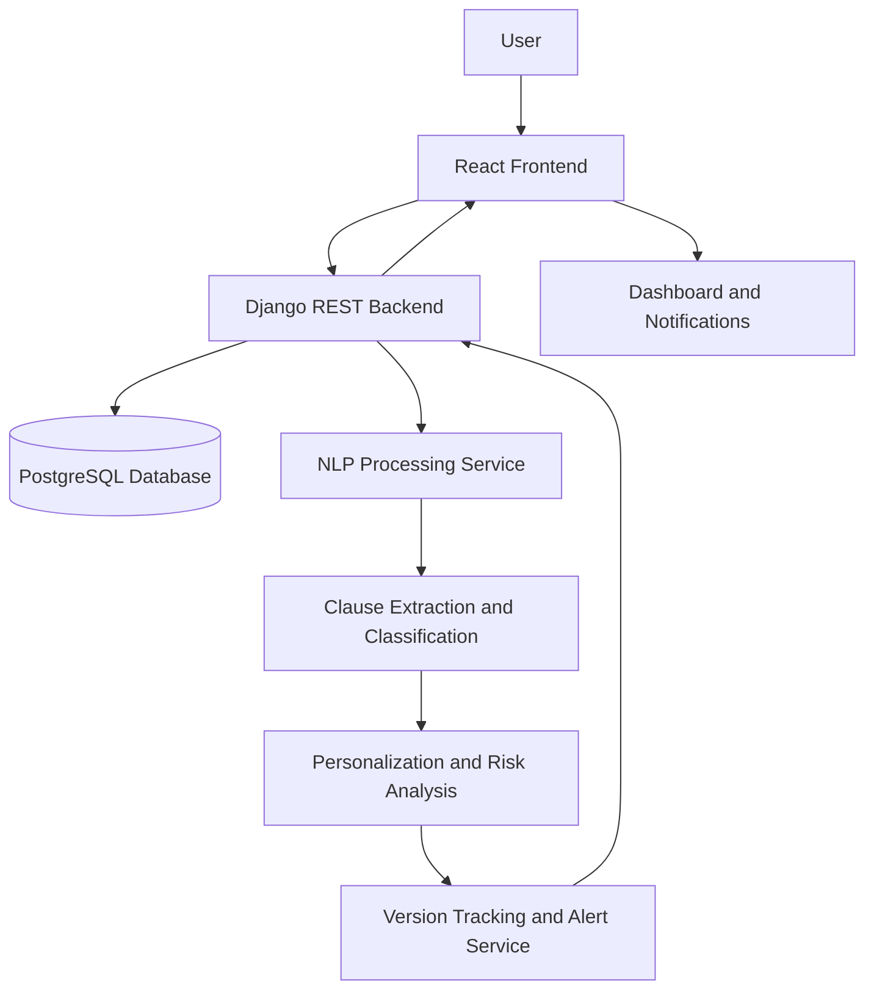

# ClauseLens
### Context-Aware Terms & Conditions Risk Summarization with Version-Diff Personalized Alerts

<p align="center">
  <strong>Understand the Fine Print. Identify the Risks. Stay Informed.</strong>
</p>

<p align="center">
  An AI-powered platform that simplifies complex Terms & Conditions and Privacy Policies through intelligent document analysis, personalized risk assessment, policy version tracking, and automated alerts.
</p>

<p align="center">
  
  
  
  
  
  
</p>

---

## Table of Contents

1. [Introduction](#1-introduction)
2. [Problem Statement](#2-problem-statement)
3. [Project Objectives](#3-project-objectives)
4. [Key Features](#4-key-features)
5. [System Architecture](#5-system-architecture)
6. [Technology Stack](#6-technology-stack)
7. [Project Structure](#7-project-structure)
8. [System Workflow](#8-system-workflow)
9. [Personalized Risk Assessment](#9-personalized-risk-assessment)
10. [Alert Generation Model](#10-alert-generation-model)
11. [Installation and Setup](#11-installation-and-setup)
12. [Environment Configuration](#12-environment-configuration)
13. [Running the Application](#13-running-the-application)
14. [API Integration](#14-api-integration)
15. [GitHub Collaboration](#15-github-collaboration)
16. [Testing](#16-testing)
17. [Security and Privacy](#17-security-and-privacy)
18. [Project Limitations](#18-project-limitations)
19. [Future Enhancements](#19-future-enhancements)
20. [Team Contributions](#20-team-contributions)
21. [Acknowledgements](#21-acknowledgements)
22. [Disclaimer](#22-disclaimer)
23. [License](#23-license)

---

## 1. Introduction

**ClauseLens** is an AI-powered platform designed to help users understand complex Terms & Conditions and Privacy Policies in simple and accessible language.

Digital platforms frequently update their legal policies. These documents contain important information about personal data collection, third-party sharing, automatic renewals, liability limitations, arbitration, account termination, and user rights.

However, most users accept these agreements without fully understanding their implications.

ClauseLens addresses this challenge by combining Natural Language Processing (NLP), Machine Learning, semantic similarity, personalized risk assessment, and automated policy comparison.

The platform analyzes uploaded legal documents, identifies important clauses, explains potential risks according to individual user profiles, monitors publicly accessible policy pages, and generates personalized alerts when meaningful changes are detected.

**Our Vision:** Transform complex legal documents into understandable, personalized, and actionable insights.

---

## 2. Problem Statement

Users regularly accept digital service agreements without fully understanding their implications.

Traditional Terms & Conditions analysis has several limitations:

- Legal documents are lengthy and difficult to understand.
- Important clauses are often hidden within complex legal language.
- Generic summaries do not consider individual user circumstances.
- Users may not know when websites update their policies.
- Comparing different policy versions manually is time-consuming.
- Policy changes may affect different users in different ways.

ClauseLens aims to address these challenges through automated document understanding, personalized analysis, and policy version tracking.

---

## 3. Project Objectives

The primary objectives of ClauseLens are:

1. **Simplify Legal Language:** Convert complex legal clauses into easy-to-understand explanations.

2. **Identify Important Clauses:** Automatically detect relevant sections such as data sharing, liability, arbitration, auto-renewal, and account termination.

3. **Personalized Risk Assessment:** Evaluate clauses according to user preferences, age group, intended use, and jurisdiction.

4. **Policy Version Tracking:** Maintain policy versions and identify changes between previous and updated documents.

5. **Automated Change Detection:** Classify policy changes as added, removed, modified, or unchanged.

6. **Personalized Alerts:** Notify users about meaningful policy changes based on their individual relevance scores.

7. **Improve User Awareness:** Help users make more informed decisions when interacting with digital services.

---

## 4. Key Features

### 4.1 AI-Based Document Analysis

- Upload Terms & Conditions and Privacy Policy documents.
- Extract text from PDF documents.
- Divide documents into meaningful clauses.
- Identify important legal categories.
- Generate simplified explanations.
- Highlight potentially significant clauses.

### 4.2 Clause Classification

The system is designed to identify categories such as:

| Category | Description |
|---|---|
| Data Collection | Information collected from users |
| Data Sharing | Sharing information with third parties |
| Data Retention | Duration of personal data storage |
| Liability Limitation | Restrictions on service-provider liability |
| Arbitration and Jurisdiction | Dispute resolution and governing jurisdiction |
| Auto-renewal and Fees | Subscription renewal and payment conditions |
| Account Termination | Conditions for suspending or terminating accounts |
| Children and Age | Age-related restrictions and protections |
| Content License | Rights granted over user-generated content |
| Unilateral Changes | Changes made to terms by service providers |

### 4.3 Personalized Risk Analysis

ClauseLens considers user context to determine which clauses may be more relevant to an individual.

Example user attributes:

- Age group
- Intended use
- Jurisdiction
- User preferences

The system generates relevance scores and ranks clauses according to their personalized importance.

### 4.4 Policy Monitoring

- Register publicly accessible policy URLs.
- Periodically retrieve policy content.
- Generate content hashes.
- Detect meaningful policy updates.
- Maintain historical policy versions.

### 4.5 Version Comparison

The system compares previous and updated policy versions.

Detected change types:

- **Added:** A new clause appears.
- **Removed:** An existing clause disappears.
- **Modified:** An existing clause changes.
- **Unchanged:** A clause remains the same.

### 4.6 Personalized Notifications

When meaningful policy changes are identified, ClauseLens generates alerts based on personalized relevance, change direction, and change magnitude.

### 4.7 Interactive Dashboard

The dashboard is designed to provide:

- Document statistics
- Analysis summaries
- Risk distribution
- Recent documents
- Monitored policies
- Version history
- Policy change summaries
- Personalized notifications

---

## 5. System Architecture

ClauseLens follows a modular architecture consisting of six independently developed components.

### Architecture Diagram

The following diagram represents the planned system architecture.



### Architecture Components

| Component | Responsibility |
|---|---|
| Frontend | User interface and dashboard |
| Backend | Central API, authentication, and service orchestration |
| Database | Persistent application data storage |
| NLP Processing | Document extraction, clause classification, and summarization |
| Personalization | User-specific relevance scoring and clause ranking |
| Version Tracking | Policy comparison, change assessment, and alert generation |

### Architectural Principles

- Modular development
- Separation of responsibilities
- API-based communication
- Reusable service components
- Centralized application data management
- Independent module testing
- Scalable integration design

---

## 6. Technology Stack

### Frontend

| Technology | Purpose |
|---|---|
| React.js | User interface development |
| Vite | Frontend development environment |
| JavaScript | Application logic |
| Tailwind CSS | Styling and responsive layouts |
| React Router | Page navigation |
| Axios | API communication |
| Recharts | Dashboard visualizations |
| Lucide React | Interface icons |

### Backend

| Technology | Purpose |
|---|---|
| Python | Backend programming |
| Django | Backend framework |
| Django REST Framework | REST API development |
| PostgreSQL | Application database |
| JWT | Authentication |
| Celery | Background task processing |
| Redis | Task queue and message broker |
| Swagger / OpenAPI | API documentation |

### NLP and AI

| Technology | Purpose |
|---|---|
| Python | NLP development |
| FastAPI | NLP service API |
| PyMuPDF | PDF text extraction |
| spaCy | Natural Language Processing |
| Hugging Face Transformers | Language model integration |
| Sentence Transformers | Semantic embeddings |
| Pydantic | Data validation |

### Personalization and Risk Analysis

| Technology | Purpose |
|---|---|
| Python | Service implementation |
| NumPy | Numerical computation |
| Pandas | Data processing |
| Scikit-learn | Similarity and evaluation utilities |
| Sentence Transformers | Semantic representation |
| FastAPI | Service API |

### Version Tracking and Alerts

| Technology | Purpose |
|---|---|
| Python | Implementation |
| Requests | HTTP requests |
| BeautifulSoup | HTML parsing |
| Playwright | Optional browser-based rendering |
| hashlib | Content hashing |
| difflib | Text comparison |
| Celery | Scheduled monitoring |
| Redis | Background task management |

---

## 7. Project Structure

The project uses one shared GitHub repository with six independent development folders.

```text
ClauseLens/
│
├── frontend/
│   ├── public/
│   ├── src/
│   ├── package.json
│   └── README.md
│
├── backend/
│   ├── config/
│   ├── apps/
│   ├── manage.py
│   ├── requirements.txt
│   └── README.md
│
├── database/
│   ├── schema/
│   ├── diagrams/
│   ├── sample_data/
│   └── README.md
│
├── nlp-processing/
│   ├── app/
│   ├── tests/
│   ├── requirements.txt
│   └── README.md
│
├── personalization/
│   ├── app/
│   ├── tests/
│   ├── requirements.txt
│   └── README.md
│
├── version-alerts/
│   ├── app/
│   ├── tests/
│   ├── requirements.txt
│   └── README.md
│
├── .gitignore
├── README.md
└── CONTRIBUTING.md
```

*The internal folder structures may evolve during implementation. The root README describes the agreed module boundaries.*

---

## 8. System Workflow

The planned end-to-end workflow is as follows:

**Step 1 – User Interaction**

The user accesses the ClauseLens frontend and uploads a Terms & Conditions or Privacy Policy PDF.

Alternatively, the user can register a publicly accessible policy URL for monitoring.

**Step 2 – Backend Processing**

The Django backend receives the request, validates the input, handles authentication, and coordinates the required services.

**Step 3 – Document Storage**

Document metadata and relevant application records are stored in PostgreSQL.

**Step 4 – NLP Processing**

The NLP service:

- Extracts document text.
- Segments the text into clauses.
- Identifies clause categories.
- Generates semantic embeddings.
- Produces simplified explanations.

**Step 5 – Personalized Risk Analysis**

The personalization service evaluates extracted clauses using the user's profile and calculates personalized relevance scores.

**Step 6 – Version Tracking**

For monitored policies, the version tracking service:

- Fetches the latest public policy content.
- Calculates its content hash.
- Compares it with the previous version.
- Identifies added, removed, and modified clauses.

**Step 7 – Alert Generation**

The alert service combines personalized relevance with change direction and magnitude to calculate an alert score.

**Step 8 – Result Delivery**

The backend provides processed results to the frontend.

The user can view summaries, clause-level analysis, risk assessments, policy changes, and notifications through the dashboard.

---

## 9. Personalized Risk Assessment

ClauseLens uses a research-based relevance model to estimate how important a clause may be for a particular user.

The proposed relevance formula is:

R(c,u) = S(c) × [λ × max(0, cos(e_c,e_u)) + (1−λ) × L(c,j_u,b_u)]

Where:

| Symbol | Meaning |
|---|---|
| R(c,u) | Personalized relevance of clause c for user u |
| S(c) | Severity prior of the clause category |
| λ | Weight balancing semantic and legal relevance |
| e_c | Clause embedding |
| e_u | User profile embedding |
| L | Jurisdiction and age-related legal relevance |
| j_u | User jurisdiction |
| b_u | User age group |

The semantic component measures similarity between a clause and the user's profile.

The legal relevance component represents configurable jurisdiction and age-related mappings.

The model is intended to support prioritization and awareness, not determine legal compliance.

---

## 10. Alert Generation Model

When a policy changes, the system estimates the potential direction and magnitude of that change.

The proposed alert formula is:

A(c',u) = R(c',u) × D(c') × M(c')

Where:

| Symbol | Meaning |
|---|---|
| A(c',u) | Personalized alert score |
| R(c',u) | Relevance score received from the personalization service |
| D(c') | Estimated direction of change |
| M(c') | Estimated magnitude of change |

### Example

Suppose:

- Personalized relevance = 0.90
- Change direction = 1.00
- Change magnitude = 0.80

Then:

A = 0.90 × 1.00 × 0.80 = 0.72

The result is an illustrative alert score of 0.72.

### Initial Configurable Priority Ranges

| Alert Score | Priority |
|---|---|
| 0.75–1.00 | High |
| 0.40–0.74 | Medium |
| 0.01–0.39 | Low |
| 0.00 | No risk-increasing alert |

These thresholds are initial project settings and should be evaluated and refined during testing.

Uncertain change assessments should be flagged for human review.

---

## 11. Installation and Setup

### Prerequisites

Install the following tools before starting development:

| Tool | Purpose |
|---|---|
| Git | Version control |
| Python 3.11+ | Backend and AI services |
| Node.js and npm | Frontend |
| PostgreSQL | Database |
| Redis | Background processing |
| VS Code or Antigravity | Development environment |

### Clone the Repository

Clone the shared project repository:

`git clone https://github.com/haniharish/ClauseLens.git`

Move into the project directory:

`cd ClauseLens`

### Create a Development Branch

Each team member should create or switch to their assigned branch.

Example:

`git checkout -b member-2-backend`

Do not develop directly on the main branch.

### Backend Setup

Move into the backend folder:

`cd backend`

Create a virtual environment:

`python -m venv venv`

Activate it on Windows:

`venv\Scripts\activate`

Activate it on macOS/Linux:

`source venv/bin/activate`

Install dependencies:

`pip install -r requirements.txt`

Apply database migrations:

`python manage.py migrate`

Create an administrative account:

`python manage.py createsuperuser`

Start the backend development server:

`python manage.py runserver`

Default development address:

`http://127.0.0.1:8000/`

### Frontend Setup

Move into the frontend folder:

`cd frontend`

Install dependencies:

`npm install`

Start the frontend:

`npm run dev`

Open the local URL printed by Vite in the terminal.

### NLP Service Setup

Move into the NLP folder:

`cd nlp-processing`

Install dependencies:

`pip install -r requirements.txt`

Start the service, assuming its entry point is `app.main:app`:

`uvicorn app.main:app --reload --port 8001`

### Personalization Service Setup

Move into the personalization folder:

`cd personalization`

Install dependencies:

`pip install -r requirements.txt`

Start the service, assuming its entry point is `app.main:app`:

`uvicorn app.main:app --reload --port 8002`

### Version Tracking Service Setup

Move into the version tracking folder:

`cd version-alerts`

Install dependencies:

`pip install -r requirements.txt`

Start the service, assuming its entry point is `app.main:app`:

`uvicorn app.main:app --reload --port 8003`

*The FastAPI commands above are conventions for the proposed structure. Use the actual entry point implemented by each member.*

---

## 12. Environment Configuration

Sensitive configuration must be stored in environment variables.

Each module should maintain its own `.env.example` file containing required variable names without real secrets.

Example backend configuration:

- DEBUG=True
- SECRET_KEY=replace-with-a-secure-secret
- DATABASE_NAME=clauselens
- DATABASE_USER=postgres
- DATABASE_PASSWORD=replace-with-local-password
- DATABASE_HOST=localhost
- DATABASE_PORT=5432
- REDIS_URL=redis://localhost:6379/0
- FRONTEND_URL=http://localhost:5173
- NLP_SERVICE_URL=http://localhost:8001
- PERSONALIZATION_SERVICE_URL=http://localhost:8002
- VERSION_ALERTS_SERVICE_URL=http://localhost:8003

Example frontend configuration:

- VITE_API_BASE_URL=http://127.0.0.1:8000

Do not commit real `.env` files, passwords, API keys, tokens, or private credentials.

---

## 13. Running the Application

The project consists of multiple services that may run independently during development.

| Service | Development Address |
|---|---|
| Frontend | Vite local URL |
| Django Backend | http://127.0.0.1:8000/ |
| NLP Service | http://127.0.0.1:8001/ |
| Personalization Service | http://127.0.0.1:8002/ |
| Version Tracking Service | http://127.0.0.1:8003/ |

FastAPI services generally expose interactive documentation at `/docs`, depending on their configuration.

The complete application requires all necessary services and database connections to be configured and running.

---

## 14. API Integration

The central Django backend acts as the primary application interface.

The proposed API groups include:

| API Area | Responsibility |
|---|---|
| Authentication | Registration, login, profile access |
| Documents | Upload and retrieve documents |
| Analysis | Initiate document processing |
| Clauses | Retrieve extracted and classified clauses |
| Personalization | Request personalized relevance analysis |
| Monitoring | Register and manage policy URLs |
| Versions | Retrieve historical policy versions |
| Changes | Retrieve clause-level differences |
| Alerts | Retrieve and update notifications |
| Dashboard | Provide aggregated user statistics |

### Integration Responsibilities

- Frontend communicates with the Django backend.
- Django backend communicates with the NLP service.
- Backend obtains relevance scores from the personalization service.
- Version tracking communicates with NLP and personalization as needed.
- Version tracking provides alert payloads to the central backend.
- PostgreSQL is the authoritative application database managed through Django models and migrations.

Actual endpoint paths and request/response schemas should be documented in the relevant module README files and OpenAPI specifications as they are implemented.

---

## 15. GitHub Collaboration

**Repository:** https://github.com/haniharish/ClauseLens

All six members work in the same repository.

### Branch Assignments

| Member | Branch | Folder |
|---|---|---|
| Member 1 | member-1-frontend | frontend/ |
| Member 2 | member-2-backend | backend/ |
| Member 3 | member-3-database | database/ |
| Member 4 | member-4-nlp | nlp-processing/ |
| Member 5 | member-5-personalization | personalization/ |
| Member 6 | member-6-version-alerts | version-alerts/ |

### Development Workflow

**1. Clone the repository**

`git clone https://github.com/haniharish/ClauseLens.git`

`cd ClauseLens`

**2. Create your assigned branch**

`git checkout -b member-2-backend`

**3. Develop inside your assigned folder.**

**4. Check changed files**

`git status`

**5. Stage only your module**

`git add backend/`

**6. Commit your changes**

`git commit -m "Add backend module"`

**7. Push your branch**

`git push -u origin member-2-backend`

**8. Create a Pull Request**

Open GitHub and create a Pull Request:

- Base branch: main
- Compare branch: your assigned branch

**9. Review and merge**

The repository owner reviews changes, checks integration, and merges approved Pull Requests into main.

### Collaboration Rules

- Do not push directly to main.
- Do not create separate repositories for individual modules.
- Work inside your assigned folder.
- Avoid modifying another member's files without coordination.
- Do not commit secrets or local environment files.
- Keep module documentation updated.
- Resolve merge conflicts carefully.
- Test integration after merging.

---

## 16. Testing

Testing is an essential part of ClauseLens development.

### Unit Testing

Each module should have its own unit tests.

Examples:

- PDF text extraction tests.
- Clause classification tests.
- API validation tests.
- Personalized relevance calculation tests.
- Policy comparison tests.
- Alert score calculation tests.

### Integration Testing

Verify that:

- Frontend can communicate with the backend.
- Backend can connect to PostgreSQL.
- Backend can communicate with the NLP service.
- Personalization receives the expected clause and embedding data.
- Version tracking receives relevance scores.
- Alerts are correctly returned to the frontend.

### End-to-End Testing

The complete application should be tested using representative policy documents and sample user profiles.

No test result should be reported as successful unless the test has actually been executed.

---

## 17. Security and Privacy

ClauseLens is designed with security and responsible document processing in mind.

Important security considerations:

- JWT-based authentication.
- Secure password handling.
- Input validation.
- Restricted file upload types and sizes.
- Environment-based secret management.
- Protection against unauthorized access.
- Safe handling of public policy URLs.
- Protection against server-side request forgery (SSRF).
- Respect for website terms, robots.txt, and reasonable request limits.
- Proper exception handling and logging.

Users should only submit documents they are authorized to process.

The system should avoid exposing personal information through logs or API responses.

---

## 18. Project Limitations

The initial system may have the following limitations:

1. NLP models may misinterpret complex legal language.
2. Clause classification may produce incorrect or incomplete categories.
3. Automated risk estimates may not represent actual legal risk.
4. Website structure changes may affect policy extraction.
5. Semantic similarity does not guarantee legal equivalence.
6. Automated change direction and magnitude require evaluation.
7. Some websites may block automated retrieval.
8. Jurisdiction-specific legal mappings may require regular updates.

Human review is recommended for uncertain or high-impact findings.

---

## 19. Future Enhancements

Potential future improvements include:

- Support for additional document formats.
- Multilingual policy analysis.
- Advanced OCR for scanned documents.
- Improved semantic clause alignment.
- More sophisticated legal-domain language models.
- Explainable risk scoring.
- User-specific notification preferences.
- Advanced policy monitoring and scheduling.
- Additional jurisdiction-specific mappings.
- Improved evaluation using expert-reviewed datasets.
- Cloud deployment and scalable processing.
- Accessibility and mobile interface improvements.

---

## 20. Team Contributions

ClauseLens is developed collaboratively by a six-member team.

| Member | Role | Responsibility |
|---|---|---|
| Member 1 | Frontend Developer | User interface and dashboard |
| Member 2 | Backend Developer | Django backend and API integration |
| Member 3 | Database Developer | PostgreSQL schema and database design |
| Member 4 | NLP & AI Developer | Document processing and clause analysis |
| Member 5 | Personalization Developer | Personalized relevance and risk ranking |
| Member 6 | Version Tracking Developer | Policy comparison and alert generation |

### Development Model

The project follows a modular development approach in which each member independently develops an assigned component within a shared GitHub repository.

The individual modules are integrated through documented API contracts and a common backend architecture.

**Repository:** https://github.com/haniharish/ClauseLens

---

## 21. Acknowledgements

We acknowledge the open-source developer communities and maintainers of the technologies used in this project, including React, Django, PostgreSQL, Python, FastAPI, Hugging Face, and related libraries.

We also acknowledge the academic guidance and learning resources that support the development of this project.

---

## 22. Disclaimer

ClauseLens is an academic software development project intended for educational, research, and informational purposes.

Its automated summaries, clause classifications, relevance scores, and change assessments are not legal advice.

The platform does not determine whether a policy is legally compliant or non-compliant. Automated findings may contain errors and should be independently verified.

Users should consult qualified legal professionals for legal interpretation and decisions.

---

## 23. License

No open-source license has been selected for this repository yet.

A license should be chosen and added to the repository root before distributing the project under open-source terms.

Until then, no specific open-source reuse permissions are granted by this README.

---

<p align="center">
  <strong>ClauseLens</strong>
  <br>
  Making Complex Policies Easier to Understand.
  <br><br>
  Developed with dedication by the ClauseLens Team.
</p>
