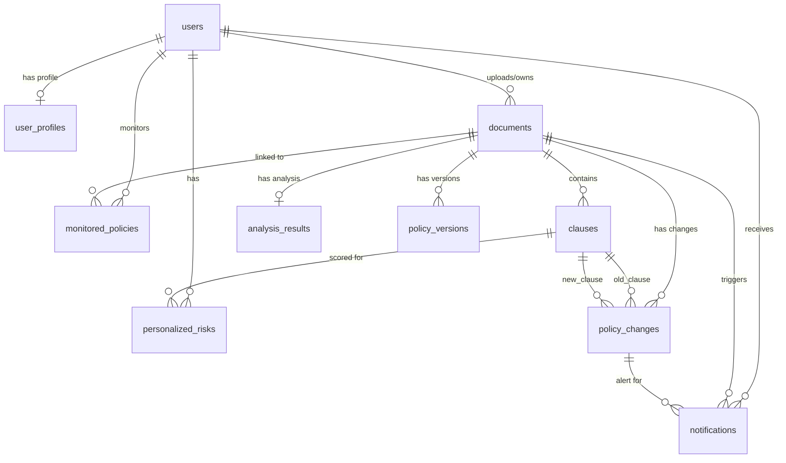

# ClauseLens – PostgreSQL Database Schema Documentation

**Coordinator:** Member 2 (Backend Lead)  
**Target Reviewer:** Member 3 (Database Lead)  
**Project:** ClauseLens: Context-Aware Terms & Conditions Risk Summarization with Version-Diff Personalized Alerts  
**Database Engine:** PostgreSQL 15+ (managed via Django ORM migrations)

---

## 1. Overview & Architecture

ClauseLens uses PostgreSQL as its primary relational database. The schema is organized into 7 modular Django apps with normalized relationships, explicit foreign keys, indexing on queried fields, and cascade rules designed for multi-tenant data integrity.

### Entity Relationship Diagram

---

## 2. Table Specifications

### A. `users` (App: `accounts`)
Primary authentication entity. Uses email as unique login identifier with Argon2/PBKDF2 password hashing.

| Column | Type | Constraints | Description |
|--------|------|-------------|-------------|
| `id` | BIGINT | PRIMARY KEY, AUTO_INCREMENT | Unique user identifier |
| `username` | VARCHAR(150) | UNIQUE, NOT NULL | Display name / handle |
| `full_name` | VARCHAR(255) | BLANK | Full legal name |
| `email` | VARCHAR(254) | UNIQUE, NOT NULL, INDEX | Primary login email |
| `password` | VARCHAR(128) | NOT NULL | Securely hashed password |
| `date_joined` | TIMESTAMPTZ | NOT NULL, DEFAULT NOW() | Registration timestamp |
| `is_active` | BOOLEAN | NOT NULL, DEFAULT TRUE | Account active flag |
| `is_staff` | BOOLEAN | NOT NULL, DEFAULT FALSE | Staff / admin status |
| `is_superuser` | BOOLEAN | NOT NULL, DEFAULT FALSE | Superuser permission flag |
| `last_login` | TIMESTAMPTZ | NULL | Last login timestamp |

**Indexes:**
- `users_email_idx` (`email`)
- `users_username_idx` (`username`)

---

### B. `user_profiles` (App: `profiles`)
Contextual profile data used by the personalization engine (Member 5) to compute legal/contextual risk relevance $R(c,u)$.

| Column | Type | Constraints | Description |
|--------|------|-------------|-------------|
| `user_id` | BIGINT | PRIMARY KEY, FK(`users.id`), ON DELETE CASCADE | 1-to-1 link to user |
| `age_group` | VARCHAR(10) | NOT NULL, DEFAULT '18_64' | `under_13`, `13_17`, `18_64`, `65_plus` |
| `intended_use` | VARCHAR(255) | NOT NULL, DEFAULT 'personal' | Comma-separated list (`personal`, `student`, `freelancer`, `business`, `parent_of_minor`) |
| `jurisdiction` | VARCHAR(10) | NOT NULL, DEFAULT 'other' | `india`, `eu`, `usa`, `other` |
| `created_at` | TIMESTAMPTZ | NOT NULL, DEFAULT NOW() | Record creation time |
| `updated_at` | TIMESTAMPTZ | NOT NULL, DEFAULT NOW() | Last update timestamp |

---

### C. `documents` (App: `documents`)
Tracks uploaded PDF documents or submitted policy URLs.

| Column | Type | Constraints | Description |
|--------|------|-------------|-------------|
| `id` | BIGINT | PRIMARY KEY, AUTO_INCREMENT | Document identifier |
| `user_id` | BIGINT | FK(`users.id`), ON DELETE CASCADE, INDEX | Document owner |
| `document_name` | VARCHAR(500) | NOT NULL | Human-readable document name |
| `document_type` | VARCHAR(10) | NOT NULL | `pdf` or `url` |
| `file` | VARCHAR(100) | NULL | File storage relative path (`media/documents/...`) |
| `policy_url` | VARCHAR(2048) | NULL | URL if document_type is 'url' |
| `status` | VARCHAR(15) | NOT NULL, INDEX, DEFAULT 'uploaded' | `uploaded`, `processing`, `completed`, `failed` |
| `uploaded_at` | TIMESTAMPTZ | NOT NULL, DEFAULT NOW(), INDEX | Upload timestamp |
| `updated_at` | TIMESTAMPTZ | NOT NULL, DEFAULT NOW() | Last status update |

**Indexes:**
- Composite index on `(user_id, status)` for fast dashboard queries
- Index on `uploaded_at` for reverse chronological ordering

---

### D. `clauses` (App: `analysis`)
Granular clauses extracted from documents by Member 4's NLP module.

| Column | Type | Constraints | Description |
|--------|------|-------------|-------------|
| `id` | BIGINT | PRIMARY KEY, AUTO_INCREMENT | Clause identifier |
| `document_id` | BIGINT | FK(`documents.id`), ON DELETE CASCADE, INDEX | Parent document |
| `clause_title` | VARCHAR(500) | NOT NULL | Descriptive title of the clause |
| `original_text` | TEXT | NOT NULL | Verbatim text from policy |
| `category` | VARCHAR(25) | NOT NULL, INDEX | Standard category (see below) |
| `severity` | DOUBLE PRECISION | NOT NULL, DEFAULT 0.0, INDEX | Objective NLP severity score $S(c) \in [0.0, 1.0]$ |
| `simple_explanation` | TEXT | NOT NULL | Plain-language AI summary |
| `created_at` | TIMESTAMPTZ | NOT NULL, DEFAULT NOW() | Extraction timestamp |

**Categories:**
- `data_collection`, `data_sharing`, `data_retention`
- `arbitration`, `liability`, `unilateral_change`
- `auto_renewal`, `content_license`, `account_termination`
- `children_age`, `other`

**Indexes:**
- Composite on `(document_id, category)`
- Index on `severity` for high-risk filtering ($\ge 0.67$)

---

### E. `analysis_results` (App: `analysis`)
High-level summary of a document's NLP analysis (1-to-1 with document).

| Column | Type | Constraints | Description |
|--------|------|-------------|-------------|
| `id` | BIGINT | PRIMARY KEY, AUTO_INCREMENT | Analysis identifier |
| `document_id` | BIGINT | UNIQUE, FK(`documents.id`), ON DELETE CASCADE | Target document |
| `total_clauses` | INTEGER | NOT NULL, DEFAULT 0 | Count of clauses |
| `high_risk_count` | INTEGER | NOT NULL, DEFAULT 0 | Count of clauses with severity $\ge 0.67$ |
| `medium_risk_count` | INTEGER | NOT NULL, DEFAULT 0 | Count of clauses with severity $\in [0.34, 0.67)$ |
| `low_risk_count` | INTEGER | NOT NULL, DEFAULT 0 | Count of clauses with severity $< 0.34$ |
| `overall_risk_score` | DOUBLE PRECISION | NOT NULL, DEFAULT 0.0 | Normalized document risk average |
| `analysis_status` | VARCHAR(15) | NOT NULL, INDEX, DEFAULT 'pending' | `pending`, `in_progress`, `completed`, `failed` |
| `created_at` | TIMESTAMPTZ | NOT NULL, DEFAULT NOW() | Completion timestamp |

---

### F. `personalized_risks` (App: `personalization`)
Relevance scores computed for a specific user and clause combination by Member 5.

$$\mathcal{R}(c,u) = S(c) \cdot \left[ \lambda \max(0, \cos(e_c, e_u)) + (1-\lambda) L(c, j_u, b_u) \right]$$

| Column | Type | Constraints | Description |
|--------|------|-------------|-------------|
| `id` | BIGINT | PRIMARY KEY, AUTO_INCREMENT | Record identifier |
| `user_id` | BIGINT | FK(`users.id`), ON DELETE CASCADE | Evaluated user |
| `clause_id` | BIGINT | FK(`clauses.id`), ON DELETE CASCADE | Evaluated clause |
| `relevance_score` | DOUBLE PRECISION | NOT NULL | Calculated score $\in [0.0, 1.0]$ |
| `risk_level` | VARCHAR(10) | NOT NULL, DEFAULT 'Medium' | `High`, `Medium`, `Low` |
| `why_it_matters` | TEXT | NOT NULL | Context-aware explanation |
| `created_at` | TIMESTAMPTZ | NOT NULL, DEFAULT NOW() | Calculation timestamp |

**Constraints & Indexes:**
- Unique constraint `(user_id, clause_id)` to prevent redundant scores
- Composite index on `(user_id, relevance_score)` for fast ranking

---

### G. `monitored_policies` (App: `monitoring`)
Policies registered by users for automated periodic version checks.

| Column | Type | Constraints | Description |
|--------|------|-------------|-------------|
| `id` | BIGINT | PRIMARY KEY, AUTO_INCREMENT | Monitoring identifier |
| `user_id` | BIGINT | FK(`users.id`), ON DELETE CASCADE | Subscribing user |
| `document_id` | BIGINT | NULL, FK(`documents.id`), ON DELETE CASCADE | Associated document |
| `policy_url` | VARCHAR(2048) | NOT NULL | Target URL being polled |
| `policy_name` | VARCHAR(500) | NOT NULL | User-provided name |
| `monitoring_status` | VARCHAR(10) | NOT NULL, INDEX, DEFAULT 'active' | `active`, `paused` |
| `check_interval_hours`| INTEGER | NOT NULL, DEFAULT 24 | Check frequency |
| `added_at` | TIMESTAMPTZ | NOT NULL, DEFAULT NOW() | Registration timestamp |
| `last_checked_at` | TIMESTAMPTZ | NULL | Timestamp of latest check |

**Constraints:**
- Unique constraint on `(user_id, policy_url)`

---

### H. `policy_versions` (App: `monitoring`)
Historical policy snapshots provided by Member 6's version tracking crawler.

| Column | Type | Constraints | Description |
|--------|------|-------------|-------------|
| `id` | BIGINT | PRIMARY KEY, AUTO_INCREMENT | Version record identifier |
| `document_id` | BIGINT | FK(`documents.id`), ON DELETE CASCADE | Associated document |
| `version_number` | INTEGER | NOT NULL | Monotonically increasing version (1, 2, ...) |
| `version_text` | TEXT | NOT NULL | Full extracted policy text |
| `content_hash` | VARCHAR(64) | NOT NULL, INDEX | SHA-256 fingerprint of `version_text` |
| `fetched_at` | TIMESTAMPTZ | NOT NULL, DEFAULT NOW() | Retrieval timestamp |

**Constraints:**
- Unique constraint on `(document_id, version_number)`

---

### I. `policy_changes` (App: `monitoring`)
Clause-level diffs detected between successive versions.

| Column | Type | Constraints | Description |
|--------|------|-------------|-------------|
| `id` | BIGINT | PRIMARY KEY, AUTO_INCREMENT | Change identifier |
| `document_id` | BIGINT | FK(`documents.id`), ON DELETE CASCADE | Changed document |
| `old_clause_id` | BIGINT | NULL, FK(`clauses.id`), ON DELETE SET NULL | Previous clause version (if modified/removed) |
| `new_clause_id` | BIGINT | NULL, FK(`clauses.id`), ON DELETE SET NULL | New clause version (if added/modified) |
| `change_type` | VARCHAR(12) | NOT NULL | `added`, `removed`, `modified`, `unchanged` |
| `change_direction` | VARCHAR(15) | NOT NULL, DEFAULT 'unclear' | `more_favorable`, `neutral`, `less_favorable`, `unclear` |
| `magnitude` | DOUBLE PRECISION | NOT NULL, DEFAULT 0.0 | Semantic diff magnitude $\in [0.0, 1.0]$ |
| `alert_score` | DOUBLE PRECISION | NOT NULL, DEFAULT 0.0 | Computed $\mathcal{A}(c', u) = \mathcal{R} \cdot \mathcal{D} \cdot \mathcal{M}$ |
| `detected_at` | TIMESTAMPTZ | NOT NULL, DEFAULT NOW() | Detection timestamp |

---

### J. `notifications` (App: `alerts`)
Personalized notifications delivered to users when alert threshold ($\ge 0.5$) is reached.

| Column | Type | Constraints | Description |
|--------|------|-------------|-------------|
| `id` | BIGINT | PRIMARY KEY, AUTO_INCREMENT | Notification identifier |
| `user_id` | BIGINT | FK(`users.id`), ON DELETE CASCADE | Recipient user |
| `document_id` | BIGINT | NULL, FK(`documents.id`), ON DELETE CASCADE | Associated document |
| `policy_change_id` | BIGINT | NULL, FK(`policy_changes.id`), ON DELETE SET NULL | Triggering change |
| `title` | VARCHAR(500) | NOT NULL | Brief summary header |
| `message` | TEXT | NOT NULL | Detailed context-aware alert text |
| `severity` | VARCHAR(10) | NOT NULL, INDEX, DEFAULT 'medium' | `high`, `medium`, `low` |
| `is_read` | BOOLEAN | NOT NULL, INDEX, DEFAULT FALSE | Read/unread status flag |
| `created_at` | TIMESTAMPTZ | NOT NULL, DEFAULT NOW(), INDEX | Notification timestamp |

**Constraints & Indexes:**
- Unique constraint on `(user_id, policy_change_id)` to guarantee zero duplicate alerts
- Composite index on `(user_id, is_read)` for high-performance badge/counter queries

---

## 3. Review Notes for Member 3 (Database Lead)

1. **Auto-generated Migrations:** All tables are implemented in Django and migrations have been generated under `apps/<app_name>/migrations/0001_initial.py`.
2. **PostgreSQL Specifics:** Ensure your PostgreSQL database collation is set to `UTF-8`.
3. **Partitioning Consideration:** If `policy_versions` or `clauses` grows into millions of records across academic benchmarks, consider table partitioning by `document_id` or date range.
4. **Coordination:** Any custom SQL views or stored procedures can be integrated through Django unmanaged models without disrupting these 10 core tables.
